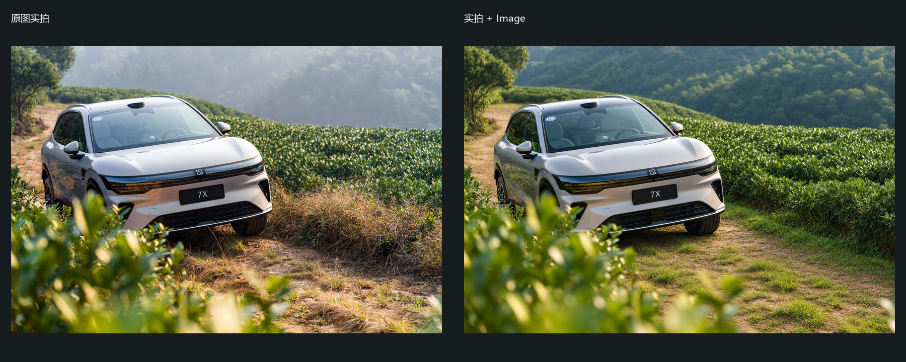
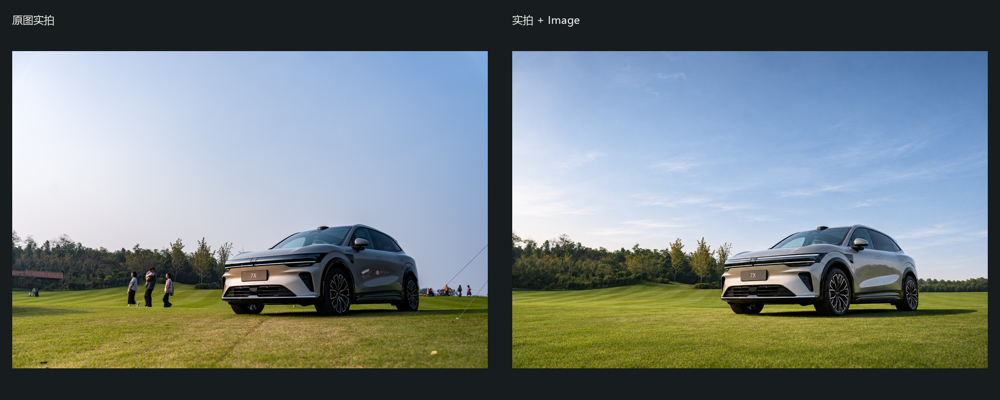
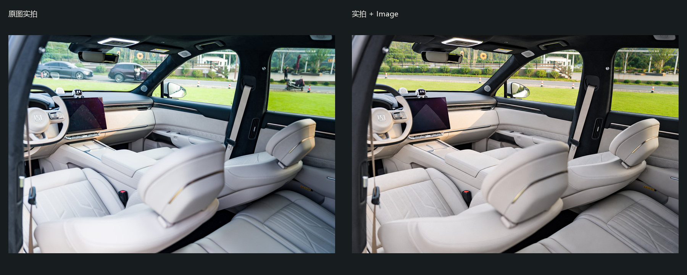
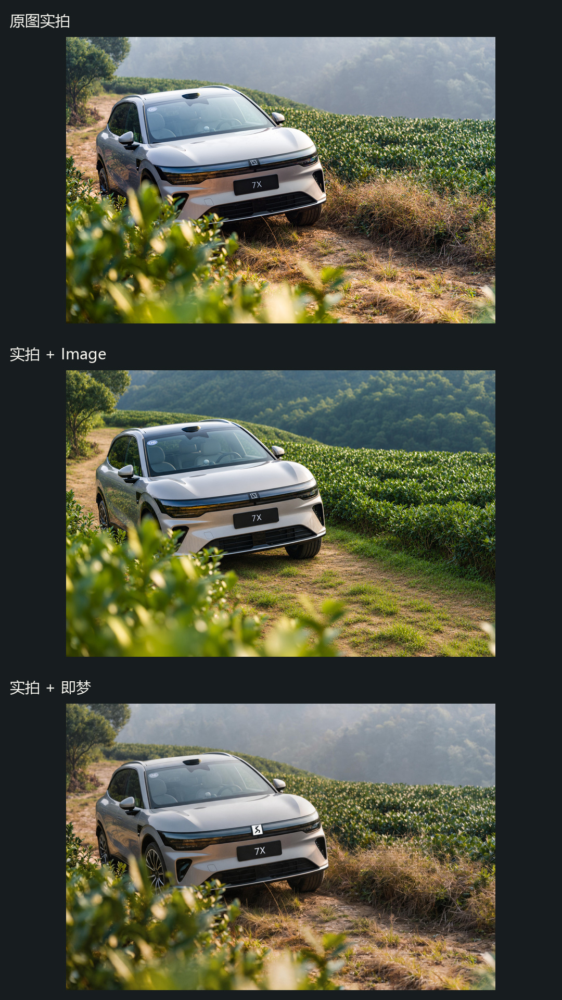
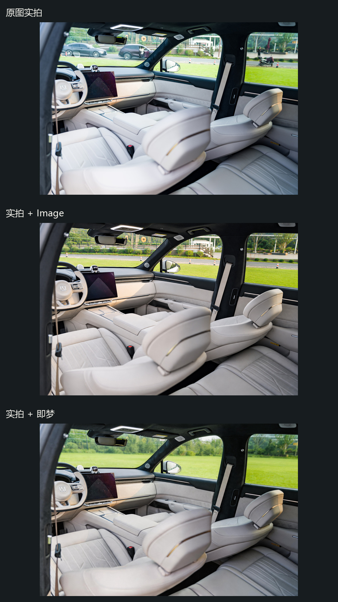
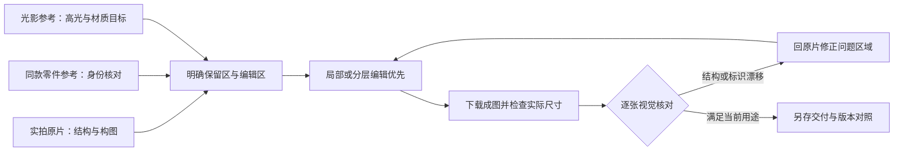

# 汽车商业精修 Skill

**实拍 + 细节参考 + AI 编辑 + 逐张核对**，把光影、清场和材质整理变成可复用的 Agent 工作流。

适用于汽车静态摄影、内饰、零件特写，以及品牌场地的航拍清理。支持调用宿主已有的 Image 编辑工具，或已安装并登录的即梦画布能力。仓库提供方法、提示词和检查/排版脚本，不包含图像模型、服务账号或一键自动修图 API。



上图保留了摄影师安排的虚化茶叶前景，改善漆面、背景和光影。这是实际生成样片；小标识、灯组和轮毂仍需对照原片核对，不能仅凭整体观感判断可交付。

## 能解决哪些问题

- 清理漆面灰尘、无关人物、背景车辆、电线、气球和杂物，同时核对倒影与阴影残留。
- 以柔和且有方向的光线表现车身曲面，区分金属、玻璃、皮革与塑料材质。
- 保留原片的前景、中景、后景、虚化与遮挡，不把构图清成平面。
- 实际传入同款车型的轮毂、灯组、车身标识参考，并逐项检查生成漂移。
- 整理批次清单与真实输出尺寸，制作带字幕的前后/三版对比。缺版本就跳过，不补造结果。

## 展示

本仓库只展示静态拍摄与内饰，未收录车辆路跑画面。对比图只缩放与排版，不额外修饰其中任一版本。详细来源、尺寸和局限见 [展示说明](docs/SHOWCASE.md)。

### 草坪静态车：清理人物，保留主体与环境关系



### 内饰：控制曝光与材质，检查窗外干扰



### 同一原片的三版对比

以下使用真实对应文件，从上到下为 **原图实拍 / 实拍 + Image / 实拍 + 即梦**。排版是 1080×1920，源图实际尺寸单独记录；没有进行公平性受控的模型基准测试，不据此评定引擎优劣。

<p>
  
  
</p>

## 安装

将仓库内 `skills/automotive-retouch` 整个目录复制到你的 Agent Skill 目录。Codex 默认目录可使用 `~/.codex/skills`；自定义 `CODEX_HOME` 时使用其 `skills` 子目录。重启或刷新宿主后发现 Skill。

Windows PowerShell：

```powershell
git clone https://github.com/498600589-byte/automotive-retouch-skill.git
$skillRoot = if ($env:CODEX_HOME) { Join-Path $env:CODEX_HOME 'skills' } else { Join-Path $env:USERPROFILE '.codex\skills' }
New-Item -ItemType Directory -Force -Path $skillRoot | Out-Null
if (Test-Path -LiteralPath (Join-Path $skillRoot 'automotive-retouch')) { throw '目标 Skill 已存在，请先比较版本。' }
Copy-Item -LiteralPath '.\automotive-retouch-skill\skills\automotive-retouch' -Destination $skillRoot -Recurse
```

macOS / Linux：

```bash
git clone https://github.com/498600589-byte/automotive-retouch-skill.git
skill_root="${CODEX_HOME:-$HOME/.codex}/skills"
mkdir -p "$skill_root"
test ! -e "$skill_root/automotive-retouch" && cp -R automotive-retouch-skill/skills/automotive-retouch "$skill_root/"
```

其他宿主按其 Skill 路径放置。安装此目录不会自动安装或登录即梦，也不会为宿主增加原本没有的 Image 工具。即梦用户从[官方网站](https://jimeng.jianying.com/)取得当前 CLI 与授权说明；本仓库不复制第三方 Skill 或 CLI 安装程序。

可选脚本需要 Python 3.10+ 与 Pillow：

```bash
python -m pip install -r requirements.txt
```

Skill 本身是 Markdown 工作流；只阅读或调用宿主图片编辑工具时不需要运行这些 Python 脚本。

## 使用

```text
使用 $automotive-retouch 精修这组实拍。
原图在 [原图目录]，细节参考在 [参考目录]，输出到 [输出目录]。
保留主车、轮毂与中心标识、灯组形状、原有虚化前景。
清除人物（含车内）、背景杂物和电线；保持柔和自然的光影与干净漆面。
使用 Image；逐张检查后汇报实际尺寸与未解决的问题。
```

换用即梦时明确工具选择，并先检查安装、登录、参考输入能力和当前费用。需要严格保留原车结构时，应要求蒙版/分层编辑或回原片修复，不能只靠重复提示词。

```text
这张只做净场：去除全部车辆、人物、地面杂物和相应阴影。
保留地面品牌文字、场地边界与赛道锥桶，轮胎轨迹保留。
```

### 可选的批次辅助命令

```bash
python skills/automotive-retouch/scripts/project.py inventory --input ./photos --output ./work/inventory.json
python skills/automotive-retouch/scripts/project.py audit --input ./edited --output ./work/outputs.json
python skills/automotive-retouch/scripts/project.py compare --images ./before.jpg ./after.png --labels "原图实拍" "实拍 + Image" --output ./work/comparison.jpg --font /path/to/chinese-font.ttf
```

三版竖屏需提供三份真实文件，标签按相同顺序填写：

```bash
python skills/automotive-retouch/scripts/project.py compare --images ./before.jpg ./image.png ./dreamina.jpg --labels "原图实拍" "实拍 + Image" "实拍 + 即梦" --layout vertical --width 1080 --height 1920 --output ./work/triptych.jpg --font /path/to/chinese-font.ttf
```

Windows 中文字体可用 `C:/Windows/Fonts/msyh.ttc`。脚本不会自行调用图像模型，也不会把检测文件尺寸当成质量验收。`inventory` 默认只读当前目录，不递归收集输出子目录；使用 `--recursive` 时务必显式排除输出与参考目录。

## 原理：把任务拆成不同约束



这里的“参考约束”是给模型更多识别依据，并非硬件级或像素级锁定。全图图生图常会重新解释车灯、文字与辐条，画布上的参考节点也不会自动创建保护蒙版。最终结构要求越严格，越应该保留原车像素，把生成限制到环境区域，再用非生成式调色处理车身。详情见 [Skill](skills/automotive-retouch/SKILL.md)、[提示词模板](skills/automotive-retouch/references/prompts.md) 与 [验收要点](skills/automotive-retouch/references/quality.md)。

## 注意事项

1. **Logo、灯组、轮毂先验收。** 参考图并不能保证原样复现，文字和微小徽标尤其容易漂移。需要分层修复或原件合成时如实说明。
2. **按画面理解清场。** 主体双车不能当背景车删除；虚化茶叶不是杂物；赛道设施和轮胎轨迹可有意保留。去人物时还要查看车内、帐篷旁和玻璃反射。
3. **保留光学与物理关系。** 不能让车轮漂浮、倒影错位，或让天空与车身高光相互矛盾。清洁不等于磨掉全部纹理。
4. **用像素报告画质。** 本次 Image 样片常见 1536×1024；这不是 2K 或原片分辨率。把拼图画布做成 4K、把文件变大或超分放大，都不代表车标和原始细节真实恢复。
5. **费用按当前服务核对。** 不承诺 2K 免费，不承诺每张固定积分；登录、套餐、模型版本和服务条款均可能变化。失败任务先查询再重交。
6. **发布另有边界。** 原片、参考素材和品牌标识需要相应使用权；获得修图授权不等于能公开上传全部底片。示例已经单独选片并去掉 EXIF/GPS。

## 授权与定位

原创 Skill、说明和辅助脚本使用 [MIT License](LICENSE)。展示照片与品牌标识不适用 MIT，保留各自权利，详见 [素材说明](docs/ASSETS.md)。本项目由摄影工作流实践整理，与示例中的汽车品牌、OpenAI 或即梦没有官方关联。
