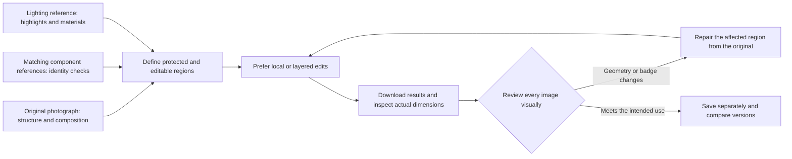

# Automotive Commercial Retouching Skill

**Real photographs + detail references + AI editing + image-by-image review** — a reusable Agent workflow for lighting, scene cleanup, and material refinement.

Designed for static automotive photography, interiors, component close-ups, and aerial cleanup of branded venues. It works with an Image editing tool already available in your Agent environment, or an installed and authenticated Jimeng (Dreamina) Canvas setup. This repository provides a workflow, prompt templates, and inspection/layout helpers. It does not include an image model, service accounts, or a one-click automated retouching API.

Lighting reference artist: **Yingchuan (颍川)** | Skill workflow design: **A Gao (阿糕)**


The example retains the photographer's deliberately blurred tea-leaf foreground while refining the paintwork, background, and lighting. It is an actual generated preview. Small badges, lights, and wheels still require comparison with the original photograph; an attractive overall result does not establish production readiness.

## What it helps with

- Remove paint dust, unrelated people, background vehicles, wires, balloons, and clutter, including remaining reflections and shadows.
- Use soft, directional light to describe body contours while preserving the differences between metal, glass, leather, and plastic.
- Preserve foreground, midground, background, depth of field, and occlusion rather than flattening the composition.
- Supply actual references for the same vehicle's wheels, lights, and badges, then check each area for generative changes.
- Track batches and actual output dimensions, and create labeled before/after or three-version comparisons. Skip incomplete sets instead of fabricating missing versions.

## Showcase

Only static photographs and interiors are shown here. **No vehicle road-running images are included.** Comparison images are resized and arranged without additional retouching of any version. See the [showcase notes](docs/SHOWCASE.md) for provenance, dimensions, and limitations.

### Static lawn photograph: remove people while preserving the subject and setting


### Interior: refine exposure and materials, and check distractions outside the windows


### Three versions of the same original photograph

These use real, corresponding files. From top to bottom: **Original photograph / Original + Image / Original + Jimeng**. The Chinese labels on the comparison images follow that order. Each layout is 1080×1920; source-image dimensions are recorded separately. These are workflow examples, not controlled benchmarks for ranking image engines.

<p>
  
  
</p>

## Installation

Copy the entire `skills/automotive-retouch` directory into your Agent's Skill directory. For Codex, the default location is `~/.codex/skills`; if you use a custom `CODEX_HOME`, use its `skills` subdirectory. Restart or refresh the host to discover the Skill.

Windows PowerShell:

```powershell
git clone https://github.com/498600589-byte/automotive-retouch-skill.git
$skillRoot = if ($env:CODEX_HOME) { Join-Path $env:CODEX_HOME 'skills' } else { Join-Path $env:USERPROFILE '.codex\skills' }
New-Item -ItemType Directory -Force -Path $skillRoot | Out-Null
if (Test-Path -LiteralPath (Join-Path $skillRoot 'automotive-retouch')) { throw 'This Skill already exists. Compare versions before replacing it.' }
Copy-Item -LiteralPath '.\automotive-retouch-skill\skills\automotive-retouch' -Destination $skillRoot -Recurse
```

macOS / Linux:

```bash
git clone https://github.com/498600589-byte/automotive-retouch-skill.git
skill_root="${CODEX_HOME:-$HOME/.codex}/skills"
mkdir -p "$skill_root"
test ! -e "$skill_root/automotive-retouch" && cp -R automotive-retouch-skill/skills/automotive-retouch "$skill_root/"
```

For other hosts, use their documented Skill directory. Installing this directory does not install or sign you into Jimeng, and it does not add an Image tool that your host does not already provide. Obtain current Jimeng CLI and authorization instructions from the [official website](https://jimeng.jianying.com/). This repository does not redistribute third-party Skills or CLI installers.

The optional helper scripts require Python 3.10+ and Pillow:

```bash
python -m pip install -r requirements.txt
```

The Skill itself is a Markdown workflow. You do not need to run the Python helpers to read it or use your host's image editing tools.

## Usage

```text
Use $automotive-retouch to retouch this set of real photographs.
Originals: [source directory]. Detail references: [reference directory]. Output: [output directory].
Preserve the main vehicle, wheels and center badges, light shapes, and existing blurred foreground.
Remove people, including occupants, background clutter, and wires. Keep natural soft lighting and clean paintwork.
Use Image. Review every result, then report actual pixel dimensions and unresolved issues.
```

When using Jimeng, specify that choice and first check installation, authentication, reference-input support, and current costs. If vehicle geometry must remain exact, use masking/layered editing or repair from the original; repeating preservation instructions alone is insufficient.

```text
For this photograph, perform scene cleanup only: remove all vehicles, people, ground clutter, and their shadows.
Preserve the painted brand lettering, venue boundaries, and course cones. Keep the tire tracks.
```

### Optional batch helpers

```bash
python skills/automotive-retouch/scripts/project.py inventory --input ./photos --output ./work/inventory.json
python skills/automotive-retouch/scripts/project.py audit --input ./edited --output ./work/outputs.json
python skills/automotive-retouch/scripts/project.py compare --images ./before.jpg ./after.png --labels "Original photograph" "Original + Image" --output ./work/comparison.jpg
```

A vertical three-version comparison requires three real files. Supply labels in the same order:

```bash
python skills/automotive-retouch/scripts/project.py compare --images ./before.jpg ./image.png ./dreamina.jpg --labels "Original photograph" "Original + Image" "Original + Jimeng" --layout vertical --width 1080 --height 1920 --output ./work/triptych.jpg
```

For Chinese labels, provide `--font` with a font that supports those characters, such as `C:/Windows/Fonts/msyh.ttc` on Windows. The scripts do not call image models or treat file-dimension checks as visual quality approval. By default, `inventory` reads only the current directory; when using `--recursive`, explicitly exclude output and reference directories.

## How it works: separate the constraints



Reference guidance gives the model more evidence; it does not provide a pixel-level lock. Full-image editing can reinterpret lights, lettering, and wheel spokes. Reference nodes on a canvas do not automatically create protective masks. The stricter the geometry requirements, the more important it is to preserve original vehicle pixels, restrict generation to environmental regions, and adjust the vehicle's lighting with non-generative tools. See the [Skill instructions](skills/automotive-retouch/SKILL.md), [prompt templates](skills/automotive-retouch/references/prompts.md), and [review checklist](skills/automotive-retouch/references/quality.md) for details. These supporting documents are currently in Chinese.

## Important considerations

1. **Review badges, lights, and wheels first.** References do not guarantee exact reproduction. Text and small emblems are especially prone to changes. Be explicit when layered repair or compositing original components is needed.
2. **Interpret cleanup in context.** A deliberate two-car composition is not an unwanted background vehicle; blurred tea leaves are not litter. Course equipment and tire tracks may be intentional. Check occupants, people near tents, and window reflections when removing people.
3. **Preserve optical and physical relationships.** Avoid floating wheels, misaligned reflections, and conflicts between the sky and body highlights. Clean surfaces should retain their texture.
4. **Report quality in pixels.** Many Image previews in this project are 1536×1024, below 2K and below the originals' resolution. A 4K comparison canvas, a larger file, or upscaling does not demonstrate recovery of authentic badge or source-image detail.
5. **Check current service costs.** Do not promise free 2K output or a fixed credit cost per image. Authentication, plans, model versions, and service terms can change. Query failed tasks before resubmitting them.
6. **Treat publication as a separate authorization.** Source photographs, references, and brand marks require appropriate usage rights. Permission to retouch does not automatically permit publishing all originals. Showcase images were selected separately and exported without EXIF/GPS metadata.

## License and attribution

The original Skill instructions, documentation, and helper scripts use the [MIT License](LICENSE). Showcase photographs and brand marks are excluded from MIT and retain their respective rights; see the [asset notes](docs/ASSETS.md). This project documents a practical photography workflow and is not officially affiliated with the automotive brands shown, OpenAI, or Jimeng.
